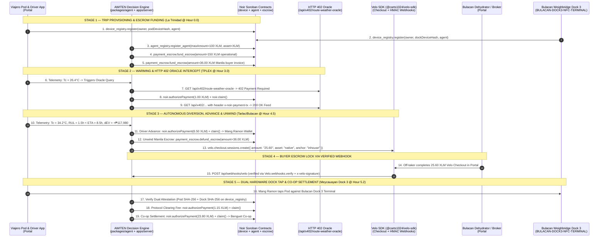

# AWITEN-Pay — Autonomous Post-Harvest Spoilage Clearinghouse & Agentic Payment Protocol on Stellar

## 1. Project Description
**AWITEN-Pay (Agri Watch Intelligence Trading Exchange Network):** An autonomous biophysical clearinghouse agent on Stellar that senses in-transit vegetable spoilage inside open-canvas Philippine *Viajero* trucks, autonomously advances driver diversion fuel via **Noir Soroban Escrow (`@noirx402/agent-sdk`)**, liquidates distressed loads to pre-contracted regional processors via **Velo Checkout (`@carts1024/velo-sdk`)**, and settles farmer cooperative payouts on physical NFC dock handoff.

---

## 2. Team Name & Members
- **Team Name:** `WalangKenen` (Founders of `AWITEN.ai` — Top 2 Winner, DICT Philippine Startup Challenge XI Region 1)
- **Members:**
  - **John Dominic S. Ragudo (`BS Computer Engineering`)** — Systems Architect, Noir Soroban Contract Integration & 3-Layer Arrhenius RUL Decision Engine
  - **Lee Marc C. Macalanda (`BS Computer Engineering`)** — *Viajero* Clip-On Telemetry Pod (`ESP32-S3 + Dual SHT40 + NFC`) & SHA-256 Hardware Attestation
  - **Nesrine P. Landingin (`BS Information Technology`)** — 3-Portal Clearinghouse UI, Velo Checkout Pipeline & Driver Mobile NFC Companion

---

## 3. Live Links
- **Live Deployed Web Application (Required Working Site):** [`https://awiten-pay.onrender.com`](https://awiten-pay.onrender.com)
- **Direct Portal #3 Link (Mang Ramon Viajero Driver & Dock NFC Handoff Mobile App):** [`https://awiten-pay.onrender.com/?role=driver`](https://awiten-pay.onrender.com/?role=driver)
- **Live Velo Webhook Endpoint:** `https://awiten-pay.onrender.com/api/webhooks/velo`
- **Live Webhook Tester (HTTP 200 / ?status=500 Failure Demo):** [`https://awiten-pay.onrender.com/api/webhook-tester`](https://awiten-pay.onrender.com/api/webhook-tester)
- **Live Velo Checkout Session (Bulacan Rescue Off-Taker):** [`https://www.velo-build.dev/pay/jx7f3gnymxfm9vvyhv69ny2bzx8hqbwv`](https://www.velo-build.dev/pay/jx7f3gnymxfm9vvyhv69ny2bzx8hqbwv)
- **Velo Build Project Registry (`VeloPayAccess` Active):** `https://www.velo-build.dev` (`AWITEN-Pay`)
- **Verified Stellar Testnet Proof Manifest:** [`packages/shared/src/testnet-proofs.json`](./packages/shared/src/testnet-proofs.json)
- **Local Dev Server Fallback:** `http://localhost:3001`

---

## 4. Problem Statement: The Exact Problem AWITEN-Pay Solves

`AWITEN.ai` already solves the **physical detection problem (`SENSE · PREDICT`)**: an ESP32-S3 telemetry pod under the canvas tarp detects a `34.2°C` heat spike on TPLEX and calculates that an 8-ton load of Benguet Scorpio head cabbage (`₱360,000` normal wholesale value at `₱45/kg`) has only **`1.5 hours` of Remaining Useful Life (`RUL`)** before fermentation—while Manila is still **`8.5 hours` away** (where the rotted load will be slashed to `₱120,000`, losing `-₱240,000`).

Without **`AWITEN-Pay` (`LIQUIDATE`)**, knowing the vegetables are about to rot cannot save the load on a Philippine highway. Diverting an 8-ton truck mid-transit fails in the real world because of **four financial and principal-agent breakdowns**:

### Failure A: Driver Cash-Handling Fraud & Moral Hazard ("Bawas", Fake Distress, & Fuel Skimming)
- **The Real-World Breakdown:** In traditional *Viajero* hauling, if a cooperative sends `₱6,500` emergency cash to a driver's personal GCash to divert to a secondary buyer, or lets the driver negotiate a distress sale in cash on the side of the highway, three types of fraud happen:
  1. **Fake Distress (*"Palit-Karga" / Collusion*):** A driver claims the vegetables overheated mid-highway, diverts to an accomplice buyer for cash, and reports a partial loss to the co-op.
  2. **Fuel & Toll Advance Skimming:** The driver pockets the `₱6,500` emergency diversion cash and stays on the original route anyway.
  3. **Cash Short-Changing (*"Bawas"*):** When the secondary buyer pays in cash at the loading dock, the driver under-reports the final weight or price paid per kilo and pockets the spread.
- **How `AWITEN-Pay` Eliminates It (`device_registry` + `agent_registry` + Velo Checkout):**
  - **Zero Driver Cash Handling on Cargo Sale:** The Bulacan processor's `25.60 XLM` (`₱256,000`) rescue payment **never touches the driver's hands**. It is paid directly through a hosted **Velo Checkout session** (`apps/server/src/index.js`) and locked in Stellar escrow until settlement goes straight to the **Benguet Highland Co-op wallet** (`GA25IKKS...QZPN`).
  - **Cryptographic Proof of Distress (No Fake Diversions):** The autonomous agent refuses to trigger a diversion or release a fuel advance unless the distress payload carries a valid HMAC-SHA256 hardware signature (`verifyHardwareProof`) from the truck's registered `device_registry` pod (`BGT-402-POD-ESP32S3`).
  - **Dual-Hardware Dock Attestation (No Weight/Delivery Fraud):** Final settlement and driver incentive clearance require **two independent hardware signatures** registered in `device_registry` (`CB4DPMGOA374JIB2ZVD4AHW5GJKQUYNOFGRYNOJ75EFH2KCJSMHOWIRA`): the truck pod (`BGT-402-POD-ESP32S3`) and the processor's stationary weighbridge NFC terminal (`BULACAN-DOCK3-NFC-TERMINAL`) at Dock 3.

### Failure B: 2:00 AM Highway Liquidity Paralysis
- **The Real-World Breakdown:** Highland vegetable trucks travel between `11:00 PM` and `6:00 AM`. Drivers are given exact cash for planned tolls and diesel. When a thermal spike hits at `3:30 AM` approaching the TPLEX Carmen exit, the co-op treasurer is asleep, rural banks are closed, and the truck has **12 minutes** before passing the exit ramp.
- **How `AWITEN-Pay` Eliminates It (`agent_registry` + `x402`):**
  - The cooperative pre-authorizes the **AWITEN Clearinghouse Agent** in `agent_registry` (`CBTDMJVCFQDIVWZBKAKZ2FQ3UEJNAAUFYCTJ3E4ON2MYXPLPSIXQ25JZ`) with a hard on-chain spending cap (`100.00 XLM`), asset whitelist (`XLM`), and 24-hour expiry.
  - While the truck rolls at `60 km/h`, the agent autonomously pays `1.00 XLM` to unlock the `x402` Route & Weather Oracle (`apps/server/src/index.js`) and disburses the exact `6.50 XLM` (`₱6,500`) NLEX toll and diesel advance in 5 seconds via `payment_escrow`—zero human wake-up call required.

### Failure C: Gate-Side Hostage Bargaining ("Bakaw" Price-Slashing)
- **The Real-World Breakdown:** In Balintawak/Divisoria, once an unrefrigerated truck arrives with wilting outer leaves, wholesale brokers know the farmer cannot drive the load back up to Benguet. They slash the price by `60%–70%` at the gate (`₱45/kg -> ₱15/kg`, leaving `₱120,000`), or if a truck diverts to a provincial processor on a verbal phone promise, the processor lowballs the price once the truck is parked at their dock.
- **How `AWITEN-Pay` Eliminates It (`@carts1024/velo-sdk` + `Velo.webhooks.verify`):**
  - Before Mang Ramon completes the dock handoff in Pulilan, Bulacan, the secondary buyer (*Bulacan Agro-Dehydration & Pickling Corp.*) must lock the `25.60 XLM` (`₱256,000` at `₱32/kg`) distress floor via **Velo Checkout**.
  - The server verifies the cryptographic `x-velo-signature` via `Velo.webhooks.verify({ payload, signature, secret })` (`apps/server/src/index.js`). The price is locked in code before a single crate is unloaded.

### Failure D: Multi-Party Escrow Gridlock on Diverted Cargo
- **The Real-World Breakdown:** When a truck bound for a primary Manila buyer (`₱360,000` invoice) is diverted mid-highway to a secondary Bulacan processor (`₱256,000` rescue order), three ledgers collide: the original Manila buyer's locked deposit, the driver's `₱6,500` emergency fuel advance, and the secondary buyer's rescue payment.
- **How `AWITEN-Pay` Eliminates It (`payment_escrow` Atomic Unwind & Settlement):**
  - The instant the Bulacan Dock 3 NFC tap is verified (`apps/server/src/index.js`), the agent executes an atomic 3-step settlement on `payment_escrow` (`CA5S4S7QGHJHJWVJBYL3CXZXZTNGKXMNZVDAEQNN7NUXFP4D7BYK7HIX`):
    1. **`defund_escrow` (`36.00 XLM` / `₱360,000`):** Refunds the original Manila buyer's locked escrow because the truck was diverted.
    2. **`authorize + claim` (`1.15 XLM` / `₱11,520`):** Collects the `4.5%` AWITEN clearinghouse fee (`₱6,500` fuel advance already disbursed at Hour 4.5).
    3. **`authorize + claim` (`23.80 XLM` / `₱237,980`):** Settles the net rescue payout directly to the Benguet Highland Co-op—saving **`+₱117,980` (`+98.3%`)** over the `₱120,000` Manila spoilage loss.

---

## 5. How AWITEN-Pay Agent Works
The `AWITEN-Pay` autonomous agent (`packages/agent/src/decision-engine.js` + `noir-service.js`) runs a deterministic **3-Layer Biophysical & Economic Loop** on every telemetry frame emitted by the clip-on sensor pod (`BGT-402-POD-ESP32S3`):

### Layer 1: Biophysical Telemetry & Arrhenius RUL Evaluator
Given canopy temperature $T_c(t)$ and relative humidity $\text{RH}(t)$:
- **Vapor Pressure Deficit ($\text{VPD}$ in $\text{kPa}$):**
  $$e_s(T_c) = 0.61078 \exp\left(\frac{17.27 \, T_c}{T_c + 237.3}\right), \quad \text{VPD}(t) = \max\left(0.15, \, e_s(T_c)\left(1 - \frac{\text{RH}}{100}\right)\right)$$
- **Arrhenius Respiratory Heat ($Q_{10} = 2.15$):**
  $$R_{\text{resp}}(T_c) = 28.0 \times 2.15^{(T_c - 10)/10} \text{ mW/kg}$$
- **Remaining Useful Life ($\text{RUL}$ to Grade 3 Floor $F = 50$):**
  $$v_{\text{decay}}(T_c) = \max\left(2.2, \, 0.42(T_c - 15)\right), \quad \text{RUL}(t) = \max\left(0.3, \, \frac{F(t) - 50}{v_{\text{decay}}(T_c)}\right)$$
At `Hour 4.5` (Tarlac/Bulacan Junction), $T_c = 34.2^\circ\text{C}$, $\text{RH} = 54\%$, $\text{VPD} = 2.47\text{ kPa}$, $R_{\text{resp}} = 179\text{ mW/kg}$, and $\text{RUL} = 1.5\text{ hrs}$ while remaining transit time to Manila is $\tau_{\text{ETA}} = 8.5\text{ hrs}$.

### Layer 2: Expected-Value (EV) Economic Solver
Using a Testnet scale where **`1.00 XLM = ₱10,000 PHP`** (so judges can test full 8-ton settlements using free Friendbot XLM):
- **Continue to Manila ($\text{EV}_{\text{Manila}}$):** `₱120,000` (`12.00 XLM`) after Grade 4 collapse.
- **Divert to Bulacan Food Dehydrator ($\text{EV}_{\text{Divert}}$):**
  $$\text{EV}_{\text{Divert}} = \text{₱256,000 Gross } (25.60\text{ XLM}) - \text{₱11,520 AWITEN 4.5\% Fee } (1.15\text{ XLM}) - \text{₱6,500 Driver Advance } (6.50\text{ XLM}) = \text{₱237,980 Net } (23.80\text{ XLM})$$
- **Net Value Rescued ($\Delta\text{EV}$):** **`+₱117,980` (`+11.80 XLM`)** back in the farmer cooperative's pocket.

### Layer 3: Autonomous On-Chain Action Triggers & Zero-Click Mode
When **Autonomous Agent Mode** is active (`#autonomousAgentToggle`), the agent acts on telemetry without human confirmation modals:
1. **`Hour < 3.0` (`HOLD_PRIMARY_ROUTE`):** Freshness $\ge 85\%$ (`Grade 1`). Farmer Firewall remains locked so destination buyers cannot view telemetry.
2. **`Hour 3.0` (`QUERY_X402_ORACLE`):** Canopy warming passes $26.4^\circ\text{C}$. The agent intercepts an **HTTP 402 Payment Required** challenge from `/api/x402/route-weather-oracle` (`x-402-price: 1.00 XLM`), autonomously signs and claims `1.00 XLM` via `@noirx402/agent-sdk`, passes `x-noir-payment-tx`, and ingests the verified NLEX traffic & Bulacan dock capacity feed.
3. **`Hour 4.5` (`EXECUTE_AUTONOMOUS_DIVERSION`):** Because $\text{RUL} (1.5\text{h}) < \tau_{\text{ETA}} (8.5\text{h})$ and $\Delta\text{EV} = +\text{₱117,980} > 0$, the agent:
   - Validates the hardware attestation proof from truck pod `BGT-402-POD-ESP32S3`.
   - Disburses **`6.50 XLM` (`₱6,500` PHP Eq.)** from `payment_escrow` directly to Mang Ramon's driver wallet (`authorizePayment` + `claim`) for NLEX exit tolls and diesel.
   - Unwinds the original Balintawak Manila buyer escrow invoice of **`36.00 XLM` (`₱360,000`)** via Soroban `payment_escrow.defund_escrow`.
   - Opens a **`25.60 XLM` (`₱256,000` PHP Eq.)** **Velo Checkout Session** (`velo.checkout.sessions.create`) for the Bulacan Food Dehydrator.
4. **Stage 4 & 5 (`UNWIND & SETTLE`):** When `Velo.webhooks.verify()` confirms the signed `payment.succeeded` webhook (`x-velo-signature`) and Mang Ramon arrives at the weighbridge dock, the system validates **Dual Hardware Attestation** (`BGT-402-POD-ESP32S3` truck pod + `BULACAN-DOCK3-NFC-TERMINAL` dock terminal on `device_registry`) and executes on-chain settlement:
   - Deducts **`1.15 XLM` (`₱11,520`)** AWITEN Clearinghouse protocol fee (4.5% of gross settlement).
   - Settles **`23.80 XLM` (`₱237,980` net)** from `payment_escrow` to the Benguet Highland Co-op.

### Persistent Agent HUD Live Terminal
A slide-up bottom drawer HUD (`AWITEN Clearinghouse Agent — Live Terminal`) streams every agentic decision cycle through five operational tags:
- `[PERCEIVE]`: Ingestion of sensor frames (canopy temp, humidity, VPD, respiration rate, and HTTP 402 challenge intercepts).
- `[REASON]`: Arrhenius kinetic shelf-life decay, time-to-spoilage vs. ETA, and economic $\Delta\text{EV}$ solver output.
- `[SIGN & DISBURSE]`: Cryptographic signing and Soroban escrow disbursement of driver diversion advance funds.
- `[LIQUIDATE & ESCROW]`: Creation of regional processor Velo Checkout sessions and HMAC webhook verification.
- `[UNWIND & SETTLE]`: Original buyer escrow defunding, dual hardware NFC verification, and cooperative net settlement.

---

## 6. Architecture Diagram



---

## 7. Noir Integration Details (`@noirx402/agent-sdk`)
We integrate `@noirx402/agent-sdk` (`NoirAgentClient`, `keypairSigner`, `deviceHashScVal`, `normalizeDeviceHash`, `toStroops`, `fromStroops`, `verifyWebhookSignature`) in [`packages/agent/src/noir-service.js`](./packages/agent/src/noir-service.js).

The primary default contract set is **`SDK_DEFAULT_2026_10_07`**. Both the primary SDK default and the Nov 6 Builder Handbook (`HANDBOOK_2026_10_24`) sets have been provisioned and settled on Stellar Testnet across all 10 operations (28 total confirmed transactions):

- **Truck Sensor Pod:** `BGT-402-POD-ESP32S3` (`deviceHash`: `d7603c3286417cd3d1857dbed397eb335f78b3e91f88733ccf9e46ede663ebda`)
- **Bulacan Dock Terminal:** `BULACAN-DOCK3-NFC-TERMINAL` (`deviceHash`: `8edde7503399cbd8da0aa0023c7184aee38e088ab5823ab7c8fe467a0b65a7e4`)

### 7.1 Primary Live Stellar Testnet Proofs — SDK Default (`2026-10-07`) Contract Set
- **`device_registry`:** `CB4DPMGOA374JIB2ZVD4AHW5GJKQUYNOFGRYNOJ75EFH2KCJSMHOWIRA`
- **`agent_registry`:** `CBTDMJVCFQDIVWZBKAKZ2FQ3UEJNAAUFYCTJ3E4ON2MYXPLPSIXQ25JZ`
- **`payment_escrow`:** `CA5S4S7QGHJHJWVJBYL3CXZXZTNGKXMNZVDAEQNN7NUXFP4D7BYK7HIX`

| Step & Operation | Contract Method | Amount | Live Stellar Expert Testnet Proof (`txHash`) |
| :--- | :--- | :--- | :--- |
| **1. Hardware Pod Attestation** | `device_registry.register` | — | [`279fb4f3aa4adac7838c4bb056f74122f4795caecedff4915ae8f3f5721dfe28`](https://stellar.expert/explorer/testnet/tx/279fb4f3aa4adac7838c4bb056f74122f4795caecedff4915ae8f3f5721dfe28) |
| **2. Dock Terminal Attestation** | `device_registry.register` | — | [`a61c8d77af87ebf7811ba2df8293b32bbc9528628df4ee52feffc5b26ba2ef11`](https://stellar.expert/explorer/testnet/tx/a61c8d77af87ebf7811ba2df8293b32bbc9528628df4ee52feffc5b26ba2ef11) |
| **3. Agent Policy Registration** | `agent_registry.register_agent` | `100.00 XLM` Cap | [`776397ba58ee55054c749cd35b492de154b4886b12b2d79d0298541090de098e`](https://stellar.expert/explorer/testnet/tx/776397ba58ee55054c749cd35b492de154b4886b12b2d79d0298541090de098e) |
| **4. Operational Escrow Fund** | `payment_escrow.fund_escrow` | `150.00 XLM` | [`3ca5f7ae30a12d167feb8218ab79e050799a405ab0d2a57a66aea6e3f6a7fd9b`](https://stellar.expert/explorer/testnet/tx/3ca5f7ae30a12d167feb8218ab79e050799a405ab0d2a57a66aea6e3f6a7fd9b) |
| **5. Original Buyer Escrow Fund** | `payment_escrow.fund_escrow` | `36.00 XLM` (`₱360,000`) | [`e007ff674ee7840ad0d4552d18deb0b796348d7ee837bbbfd85bf26981ef5cba`](https://stellar.expert/explorer/testnet/tx/e007ff674ee7840ad0d4552d18deb0b796348d7ee837bbbfd85bf26981ef5cba) |
| **6. Original Buyer Escrow Unwind** | `payment_escrow.defund_escrow` | `36.00 XLM` (`₱360,000`) | [`df5cc030658505941fcf47ac2cefb7c0271af889416d3eb86aacc07546d699d5`](https://stellar.expert/explorer/testnet/tx/df5cc030658505941fcf47ac2cefb7c0271af889416d3eb86aacc07546d699d5) |
| **7a. x402 Oracle Authorize** | `payment_escrow.authorize` | `1.00 XLM` | [`facbf05af10e964b99163996f39a51f5d95b8934b7780dadc27f260961713a29`](https://stellar.expert/explorer/testnet/tx/facbf05af10e964b99163996f39a51f5d95b8934b7780dadc27f260961713a29) |
| **7b. x402 Oracle Claim** | `payment_escrow.claim` | `1.00 XLM` | [`6e68099666f687f3d1ea85f4cdde1183c40f849b27ed0c60d6f7c206229c26bd`](https://stellar.expert/explorer/testnet/tx/6e68099666f687f3d1ea85f4cdde1183c40f849b27ed0c60d6f7c206229c26bd) |
| **8a. Driver Advance Authorize** | `payment_escrow.authorize` | `6.50 XLM` (`₱6,500`) | [`42bb2e18f8952f39f569af182aedba3911fee27f6a8ff628d1fa9ab653d30ecd`](https://stellar.expert/explorer/testnet/tx/42bb2e18f8952f39f569af182aedba3911fee27f6a8ff628d1fa9ab653d30ecd) |
| **8b. Driver Advance Claim** | `payment_escrow.claim` | `6.50 XLM` (`₱6,500`) | [`26d1feec7625b1b8a5de61edf42d0a9bf00258a33640d7719f223733a94b020a`](https://stellar.expert/explorer/testnet/tx/26d1feec7625b1b8a5de61edf42d0a9bf00258a33640d7719f223733a94b020a) |
| **9a. Clearing Fee Authorize** | `payment_escrow.authorize` | `1.15 XLM` (`₱11,520`) | [`c080ab4bbcedd682a030de33ab8f396e6add054d1938d28b1486b7f33a3c08a2`](https://stellar.expert/explorer/testnet/tx/c080ab4bbcedd682a030de33ab8f396e6add054d1938d28b1486b7f33a3c08a2) |
| **9b. Clearing Fee Claim** | `payment_escrow.claim` | `1.15 XLM` (`₱11,520`) | [`327f18be382db96a3486bd9ba76e5215518e8ae559ab848be334be7de49cae90`](https://stellar.expert/explorer/testnet/tx/327f18be382db96a3486bd9ba76e5215518e8ae559ab848be334be7de49cae90) |
| **10a. Co-op Settlement Auth** | `payment_escrow.authorize` | `23.80 XLM` (`₱237,980`) | [`3abdef9b2d30d560221e4a6075209d7e4689455779800dc028a9ca43fcb6f03b`](https://stellar.expert/explorer/testnet/tx/3abdef9b2d30d560221e4a6075209d7e4689455779800dc028a9ca43fcb6f03b) |
| **10b. Co-op Settlement Claim** | `payment_escrow.claim` | `23.80 XLM` (`₱237,980`) | [`6e72a527d8348d1d10e749c0ee33708e3479f81de244a0fb17820ecc8cd33def`](https://stellar.expert/explorer/testnet/tx/6e72a527d8348d1d10e749c0ee33708e3479f81de244a0fb17820ecc8cd33def) |

### 7.2 Secondary Live Stellar Testnet Proofs — Builder Handbook (`2026-10-24`) Contract Set
- **`device_registry`:** `CAC4KOLHDLDYDWBOKXNKRN5KVHO56PLOIFXDLTBUWGVN6GVDEB7FQHU5`
- **`agent_registry`:** `CCMZDSPTLX7IIJWCYEUM5DJUHOSOYSTHGK777S2TXZWEMC5ZZGPJ3EBV`
- **`payment_escrow`:** `CC7EAW5FNJEDBS7THM5IT6XIOHO4AOYMLXT3KSZ3HWUIKEACTW7E5BFS`

| Step & Operation | Contract Method | Amount | Live Stellar Expert Testnet Proof (`txHash`) |
| :--- | :--- | :--- | :--- |
| **1. Hardware Pod Attestation** | `device_registry.register` | — | [`fd8306cc4c903a81e4845a9654c6ee445a362356ae1edc234361b6a69bafcf70`](https://stellar.expert/explorer/testnet/tx/fd8306cc4c903a81e4845a9654c6ee445a362356ae1edc234361b6a69bafcf70) |
| **2. Dock Terminal Attestation** | `device_registry.register` | — | [`982882909fdc7c4b0097ba2553c759fc76215fa493307b82cd6d9335a34ba7e0`](https://stellar.expert/explorer/testnet/tx/982882909fdc7c4b0097ba2553c759fc76215fa493307b82cd6d9335a34ba7e0) |
| **3. Agent Policy Registration** | `agent_registry.register_agent` | `100.00 XLM` Cap | [`cd7a792ce99b2171ccdab5e1a1a50aa7431a49d9bb65a84a6f41ed244cd2f638`](https://stellar.expert/explorer/testnet/tx/cd7a792ce99b2171ccdab5e1a1a50aa7431a49d9bb65a84a6f41ed244cd2f638) |
| **4. Operational Escrow Fund** | `payment_escrow.fund_escrow` | `150.00 XLM` | [`68ecc484d8061d44b9a82ab923e7f313d5d74587dfbcd36071a53cabfe3c63b0`](https://stellar.expert/explorer/testnet/tx/68ecc484d8061d44b9a82ab923e7f313d5d74587dfbcd36071a53cabfe3c63b0) |
| **5. Original Buyer Escrow Fund** | `payment_escrow.fund_escrow` | `36.00 XLM` (`₱360,000`) | [`8f023efe609f857706fa720fd6694a383e1b2b6c3568c8107ddf8e4207cea473`](https://stellar.expert/explorer/testnet/tx/8f023efe609f857706fa720fd6694a383e1b2b6c3568c8107ddf8e4207cea473) |
| **6. Original Buyer Escrow Unwind** | `payment_escrow.defund_escrow` | `36.00 XLM` (`₱360,000`) | [`6f480cf2cdecdba9c2339cf32b3ec76ec60a94ff059fd950ece7c063fa47a8bc`](https://stellar.expert/explorer/testnet/tx/6f480cf2cdecdba9c2339cf32b3ec76ec60a94ff059fd950ece7c063fa47a8bc) |
| **7a. x402 Oracle Authorize** | `payment_escrow.authorize` | `1.00 XLM` | [`0aeae11c139d57eaa91473983df4f841e33be7af9888ff96e410d76f2a64e983`](https://stellar.expert/explorer/testnet/tx/0aeae11c139d57eaa91473983df4f841e33be7af9888ff96e410d76f2a64e983) |
| **7b. x402 Oracle Claim** | `payment_escrow.claim` | `1.00 XLM` | [`53e8d991ecdda32528110de8d365b1d2eeeefbcdc80c10991949259995be456a`](https://stellar.expert/explorer/testnet/tx/53e8d991ecdda32528110de8d365b1d2eeeefbcdc80c10991949259995be456a) |
| **8a. Driver Advance Authorize** | `payment_escrow.authorize` | `6.50 XLM` (`₱6,500`) | [`a17d6f4d2273f949b8a716f122bd4b0a302f297f12e5f827fcfbe36075481dc0`](https://stellar.expert/explorer/testnet/tx/a17d6f4d2273f949b8a716f122bd4b0a302f297f12e5f827fcfbe36075481dc0) |
| **8b. Driver Advance Claim** | `payment_escrow.claim` | `6.50 XLM` (`₱6,500`) | [`d8101c684360a1b11b87cfadd32c5992eb5923de836a581463fa8046401c0ee8`](https://stellar.expert/explorer/testnet/tx/d8101c684360a1b11b87cfadd32c5992eb5923de836a581463fa8046401c0ee8) |
| **9a. Clearing Fee Authorize** | `payment_escrow.authorize` | `1.15 XLM` (`₱11,520`) | [`e86df99b8983887c40ffede6d2e9467479e40b65cdcbd1e51f6113db2c683597`](https://stellar.expert/explorer/testnet/tx/e86df99b8983887c40ffede6d2e9467479e40b65cdcbd1e51f6113db2c683597) |
| **9b. Clearing Fee Claim** | `payment_escrow.claim` | `1.15 XLM` (`₱11,520`) | [`c996a784c78f0ca6d6ef81491e12ae8981893c645cc9fb6951ab694e30d39b33`](https://stellar.expert/explorer/testnet/tx/c996a784c78f0ca6d6ef81491e12ae8981893c645cc9fb6951ab694e30d39b33) |
| **10a. Co-op Settlement Auth** | `payment_escrow.authorize` | `23.80 XLM` (`₱237,980`) | [`4353b9a7ebe6f84529980e1f98ccbb1db06ada587b2b4f030bd34f6fa400f6f1`](https://stellar.expert/explorer/testnet/tx/4353b9a7ebe6f84529980e1f98ccbb1db06ada587b2b4f030bd34f6fa400f6f1) |
| **10b. Co-op Settlement Claim** | `payment_escrow.claim` | `23.80 XLM` (`₱237,980`) | [`f03dfcdc135f14a5039c4e6d25b583839a6b4a248484a253041ad1356212e29e`](https://stellar.expert/explorer/testnet/tx/f03dfcdc135f14a5039c4e6d25b583839a6b4a248484a253041ad1356212e29e) |

---

## 8. Velo Integration Details (`@carts1024/velo-sdk`)
We integrate `@carts1024/velo-sdk@1.0.0` in [`apps/server/src/index.js`](./apps/server/src/index.js) for merchant off-take checkout creation and cryptographic webhook verification:
1. **Hosted Off-Take Checkout (`velo.checkout.sessions.create`):**
   - When the autonomous agent triggers a Bulacan diversion (`POST /api/agent/execute-diversion`) or when an accredited regional processor clicks **`Lock Floor via Velo Checkout`** in Portal #2 (`POST /api/velo/create-checkout`), the server calls `new Velo({ apiKey }).checkout.sessions.create({ amount: '25.60', asset: 'native', anchor: 'inhouse', description: '...', successUrl, cancelUrl }, { idempotencyKey, correlationId })`.
2. **Raw-Body HMAC-SHA256 Webhook Verification (`Velo.webhooks.verify`):**
   - `POST /api/webhooks/velo` is mounted with `express.raw({ type: 'application/json' })` **before** `express.json()` so the exact byte stream is preserved.
   - Verifies `req.headers['x-velo-signature']` (`t=<timestamp>,v1=<hmac_sha256>`) via `Velo.webhooks.verify({ payload: rawBody, signature, secret: process.env.VELO_WEBHOOK_SECRET })`.
   - Upon `payment.succeeded`, transitions `buyerEscrowStatus` to `LOCKED_PAID` and unlocks Mang Ramon's Dehydrator Dock NFC Handoff CTA in Portal #3.

---

## 9. Tech Stack
- **Blockchain & Smart Contracts:** Stellar Testnet (Soroban RPC `https://soroban-testnet.stellar.org`), Native Testnet XLM SAC (`CDLZFC3SYJYDZT7K67VZ75HPJVIEUVNIXF47ZG2FB2RMQQVU2HHGCYSC`)
- **Agentic Payment SDKs:** `@noirx402/agent-sdk` (`^0.2.0`), `@carts1024/velo-sdk` (`^1.0.0`), `@stellar/stellar-sdk` (`^16.0.1`)
- **Backend Runtime:** Node.js `>=22.6.0` (ESM `"type": "module"`), Express `^4.21.0` (`apps/server`)
- **Autonomous Decision Engine:** Biophysical Magnus-Tetens VPD, Arrhenius $Q_{10}=2.15$ respiratory heat, monotonic RUL, TreeSHAP attribution, and Expected-Value ($\Delta\text{EV}$) solver (`packages/agent`)
- **3-Portal Frontend:** Vanilla ES6 + HTML5 + Botanical-Green CSS3 + `Chart.js` (`apps/web`)

---

## 10. Local Setup Instructions
```bash
# 1. Clone the repository and enter the monorepo root
cd awiten-pay

# 2. Install workspace dependencies
npm install

# 3. Copy the environment template to .env
cp env.template .env

# 4. (Optional) Re-provision fresh Stellar Testnet accounts & live Noir contract proofs
npm run setup:testnet

# 5. Run the automated verification suite (DecisionEngine + Noir SDK + Velo Webhook + UI checks)
npm test

# 6. Start the full-stack Express server + 3-Portal Web UI on http://localhost:3001
npm start
```

---

## 11. Environment Variables
All required keys are documented in [`env.template`](./env.template):

| Variable | Description |
| :--- | :--- |
| `STELLAR_NETWORK` | `testnet` |
| `STELLAR_RPC_URL` | `https://soroban-testnet.stellar.org` |
| `STELLAR_HORIZON_URL` | `https://horizon-testnet.stellar.org` |
| `NOIR_DEVICE_REGISTRY_CONTRACT_ID` | `CAC4KOLHDLDYDWBOKXNKRN5KVHO56PLOIFXDLTBUWGVN6GVDEB7FQHU5` |
| `NOIR_AGENT_REGISTRY_CONTRACT_ID` | `CCMZDSPTLX7IIJWCYEUM5DJUHOSOYSTHGK777S2TXZWEMC5ZZGPJ3EBV` |
| `NOIR_PAYMENT_ESCROW_CONTRACT_ID` | `CC7EAW5FNJEDBS7THM5IT6XIOHO4AOYMLXT3KSZ3HWUIKEACTW7E5BFS` |
| `NOIR_LEGACY_DEVICE_REGISTRY_CONTRACT_ID` | `CB4DPMGOA374JIB2ZVD4AHW5GJKQUYNOFGRYNOJ75EFH2KCJSMHOWIRA` |
| `NOIR_LEGACY_AGENT_REGISTRY_CONTRACT_ID` | `CBTDMJVCFQDIVWZBKAKZ2FQ3UEJNAAUFYCTJ3E4ON2MYXPLPSIXQ25JZ` |
| `NOIR_LEGACY_PAYMENT_ESCROW_CONTRACT_ID` | `CA5S4S7QGHJHJWVJBYL3CXZXZTNGKXMNZVDAEQNN7NUXFP4D7BYK7HIX` |
| `AGENT_SECRET_KEY` | Stellar Testnet secret key (`S...`) for the autonomous `AWITEN-Pay` agent |
| `AGENT_PUBLIC_KEY` | Stellar Testnet public key (`G...`) for the autonomous `AWITEN-Pay` agent |
| `OWNER_SECRET_KEY` | Stellar Testnet secret key (`S...`) for the Benguet Co-op device owner |
| `MERCHANT_PUBLIC_KEY` | Stellar Testnet public key (`G...`) for the co-op treasury recipient |
| `VELO_API_KEY` | Server-side API key (`velo_test_...`) from `www.velo-build.dev` |
| `VELO_WEBHOOK_SECRET` | Webhook HMAC signing secret (`whsec_...`) for `Velo.webhooks.verify()` |
| `PORT` | HTTP server port (`3001`) |
| `FRONTEND_URL` | Public URL (`http://localhost:3001`) for Velo Checkout redirect callbacks |

---

## 12. How to Test the Flow
1. **Launch or Visit the App & Connect Wallet:** Open the live deployed site at [`https://awiten-pay.onrender.com`](https://awiten-pay.onrender.com) (or run locally via `npm start` at `http://localhost:3001`). Connect your Stellar Testnet wallet using the `<velo-wallet>` widget (`Connect Wallet` / `Velo Wallet` button) in the upper-right corner before executing on-chain actions. Use the top **Instant 3-Portal Switcher Bar** to jump between portals in 1 click.
2. **Autonomous Agent Mode & Zero-Click Liquidation:**
   - In Portal #1 (`1. Dispatcher (Co-op Fleet Console)`), make sure **Autonomous Agent Mode** (`#autonomousAgentToggle`) is checked.
   - Scrub the route timeline to `3.0h (26.4°C)`: The agent intercepts HTTP 402, queries `/api/x402/route-weather-oracle`, pays `1.00 XLM` on-chain, and streams `[PERCEIVE]` logs to the Live Terminal HUD.
   - Scrub to `4.5h Divert Window (34.2°C)`: The agent perceives biophysical distress, reasons $\Delta\text{EV} = +\text{₱117,980}$, disburses `6.50 XLM` driver fuel advance, unwinds `36.00 XLM` original buyer escrow, and creates a `25.60 XLM` Velo checkout session—all without popup confirmation modals.
   - Click the bottom drawer header **`AWITEN Clearinghouse Agent — Live Terminal`** to inspect the live streaming log stream across all 5 operational stages.
3. **Portal #2 (`2. Buyer Bid (Bulacan Processor Terminal)`):**
   - Click **`Lock Floor via Velo Checkout`** to create a `25.60 XLM` (`₱256,000` floor) Velo Checkout Session via `@carts1024/velo-sdk`.
   - Click **`Simulate Verified Webhook`** to sign a real `payment.succeeded` event with `x-velo-signature` and verify it through `Velo.webhooks.verify()`.
4. **Portal #3 (`3. Driver App (Viajero Mobile Companion)`):**
   - Verify that Mang Ramon's **Noir Driver Trip Wallet** shows **`+6.50 XLM` (`₱6,500 PHP Eq.` Toll & Diesel)** with a clickable Stellar Expert transaction hash and that the **Velo Buyer Escrow** badge reads **`LOCKED_PAID (Buyer Escrow Locked via Velo)`**.
   - Tap the pulsing **`Tap Bulacan Dock NFC Terminal (BGT-402-POD)`** button. The server verifies **Dual Hardware Attestation** (`BGT-402-POD-ESP32S3` truck pod + `BULACAN-DOCK3-NFC-TERMINAL` dock terminal), releases **`23.80 XLM` (`₱237,980` net)** from `payment_escrow` to the Benguet Co-op, deducts `1.15 XLM` clearing fee, and completes on-chain settlement.

---

## 13. Key Design Decisions & Trade-offs
- **Primary SDK Default (`2026-10-07`) with Dual Contract Set Provisioning:** Because `@noirx402/agent-sdk@0.2.0` defaults to the `2026-10-07` contract addresses while the Nov 6 Builder Handbook specified the `2026-10-24` addresses, we set `SDK_DEFAULT_2026_10_07` as the primary default and provisioned all 10 operations across **both** contract sets on Stellar Testnet. Judges can inspect either set on Stellar Expert and verify live confirmed transactions.
- **Dual Hardware NFC Attestation:** Rather than relying solely on GPS coordinates, delivery verification requires cryptographic proof from both the vehicle pod (`BGT-402-POD-ESP32S3`) and the drop-off weighbridge terminal (`BULACAN-DOCK3-NFC-TERMINAL`), registered on `device_registry` and verified before co-op settlement payout.
- **Original Buyer Escrow Unwind (`defund_escrow`):** When an agricultural load is diverted mid-route, the original wholesale buyer's invoice escrow must be cleanly refunded while securing the replacement off-taker's escrow. We implement `payment_escrow.defund_escrow` to return the `36.00 XLM` Manila wholesale escrow back to the original buyer upon confirmed diversion.
- **Browser-Embedded Portal #3 (`driverView`) vs. Standalone APK:** Embedding Mang Ramon's *Viajero* Driver & Dock NFC Handoff app inside the unified web shell (`?role=driver`) lets judges test the complete 3-actor clearinghouse triangle (`Co-op Dispatcher` $\leftrightarrow$ `Bulacan Off-Taker` $\leftrightarrow$ `Viajero Driver`) from a single URL with zero mobile binary installation.
- **Farmer Firewall Privacy:** Telemetry for healthy `Grade 1` shipments (`#BGT-118` and `#NVT-309`) stays shielded until a thermal distress threshold is crossed, preventing destination brokers from weaponizing sensor data to depress prices on normal runs.

---

## 14. Future Roadmap
- **Hardware-Signed Ed25519 NFC & ATECC608B Secure Element:** Move signing of the dock handoff tap directly onto the clip-on pod's `ESP32-S3` secure element over NDEF NFC at the Bulacan weighbridge.
- **Automated PHP Fiat Off-Ramp Settlement:** Connect the Benguet Highland Co-op's `payment_escrow.claim` output to regulated Philippine peso liquidity rails so rescued payouts land directly in cooperative rural bank or GCash accounts within 60 seconds of dock weigh-in.
- **Multi-Corridor Expansion:** Scale from the Benguet–Manila vegetable corridor (`BAPTC La Trinidad` $\rightarrow$ `Bulacan / Urdaneta / Bambang`) to Nueva Vizcaya (`NVAT`) and Bukidnon–Cagayan de Oro highland cold-chain routes.
